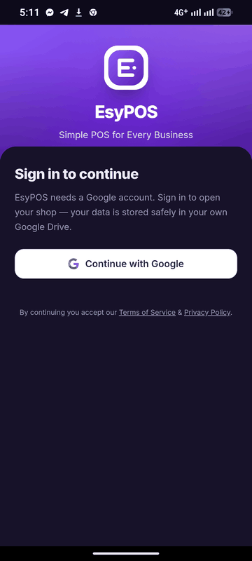

# EsyPOS

**Simple POS for Every Business**

Free · Open Source · Offline · Installable · Backup to your own Google Drive

[**Website**](https://esypos.github.io/) · [Privacy Policy](https://esypos.github.io/privacy.html) · [Terms](https://esypos.github.io/terms.html)

 

Sign in · Dashboard · Products · Customers · Purchases · Expenses · Sales · Reports · Backup · Menu

---

## About

EsyPOS is a free, open-source point-of-sale (POS) web app for small shops and growing businesses. It works in any browser, installs like a native app, runs offline, and backs up your data to **your own Google Drive**. No server, no subscription.

## Open Source

EsyPOS is an open-source project released under the **[MIT License](LICENSE)**. Anyone can run their own business with their own Google account. No third-party company or middleman is involved. You are free to use, modify and distribute it, including commercially.

## Features

- **Sales Counter:** search, barcode scan, discount, tax, hold bills
- **Payments:** Cash, Card, Mobile banking, Due
- **Receipts:** print, Bluetooth printer, WhatsApp / SMS share
- **Customers & Due:** ledger, collection, reminders
- **Products & Stock:** low-stock alerts, expiry, CSV import / export
- **Purchases, Returns & Expenses**
- **Reports:** sales, profit, collections, dashboard
- **Security:** PIN lock, automatic Google Drive backup
- **Feels like a native app:** bottom tab bar, haptic feedback, back-button handling, app-icon shortcuts (long-press the icon), instant launch from an offline cache
- **Smooth on low-end phones:** coalesced saves, cached product photos, paged lists, no heavy blur effects
- **Camera scanning:** barcode scan with built-in permission help (Chrome on Android); USB and Bluetooth scanners work everywhere

## Quick Start

1. Open **[esypos.github.io](https://esypos.github.io/)**
2. Sign in with Google once and add products (the app then opens instantly, and reconnects to Drive in the background)
3. On phone: **Add to Home screen**

## Privacy

- Data stays on **your device**. No backend server, no analytics, no ads.
- Google sign-in is optional and uses only a hidden app folder in **your** Drive.
- Camera (barcode) and Bluetooth (printer) are used only when needed.

[Full Privacy Policy](https://esypos.github.io/privacy.html)

## Terms

- Free and provided **"as is"**, without warranty.
- You are responsible for backups and the accuracy of your records.
- Tax / VAT figures are a guide only.

[Full Terms of Service](https://esypos.github.io/terms.html)

## Owner

**Mehedi Hasan** · [Facebook](https://www.facebook.com/mehedi.exx)

## License

MIT © 2026 Mehedi Hasan. See [LICENSE](LICENSE). Bundled fonts and icons: see [fonts/LICENSES.txt](fonts/LICENSES.txt).
