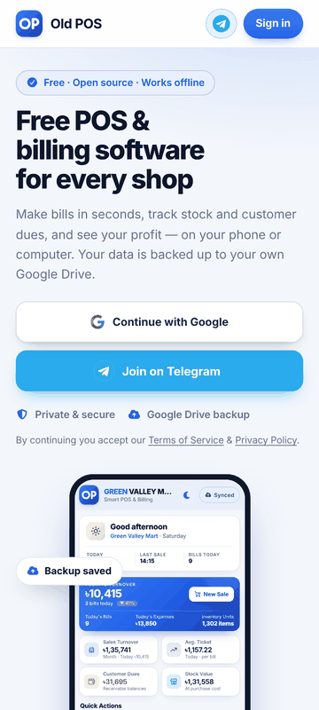
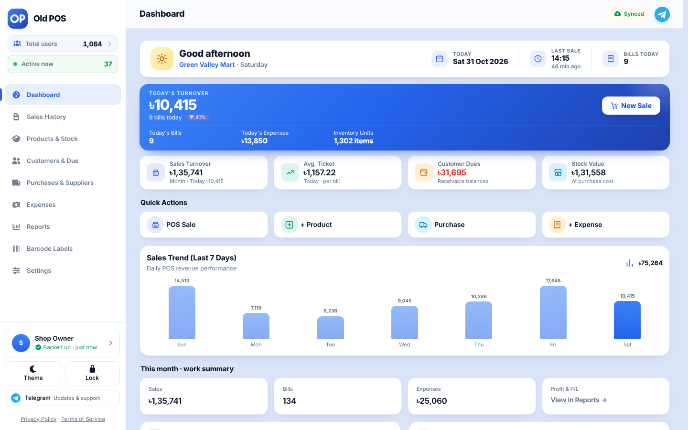

<div align="center">


# Old POS

**Simple POS for Every Business**

Free · Open Source · Offline · Installable · Backup to your own Google Drive

[**Website**](https://oldpos.com/) · [Privacy Policy](https://oldpos.com/privacy.html) · [Terms](https://oldpos.com/terms.html)

<br>



<sub>Sign in · Dashboard · Products · Customers · Purchases · Expenses · Sales · Reports · Backup · Menu</sub>


<br><sub>Desktop dashboard</sub>

</div>

---

## About

Old POS is a free, open-source point-of-sale (POS) web app for small shops and growing businesses. It works in any browser, installs like a native app, runs offline, and backs up your data to **your own Google Drive**. No server, no subscription.


## Open Source

Old POS is an open-source project released under the **[MIT License](LICENSE)**. Anyone can run their own business with their own Google account. No third-party company or middleman is involved. You are free to use, modify and distribute it, including commercially.


## Features

- **Sales Counter:** search, barcode scan, discount, tax, hold bills
- **Payments:** Cash, Card, Mobile banking, Due
- **Receipts:** print, Bluetooth printer, WhatsApp / SMS share
- **Customers & Due:** ledger, collection, reminders
- **Products & Stock:** low-stock alerts, expiry, CSV import / export
- **Purchases, Returns & Expenses**
- **Reports:** sales, profit, collections, dashboard
- **Security:** PIN lock, automatic Google Drive backup
- **Feels like a native app:** haptic feedback, back-button handling, app-icon shortcuts (long-press the icon), instant launch from an offline cache
- **Smooth on low-end phones:** coalesced saves, cached product photos, paged lists, no heavy blur effects
- **Barcode & scanner hardening (v10.8.0):** (1) Offline-cache bug fixed — `pwa.js` still said v10.7.1, so it deleted the live v10.7.5 cache; both files now say v10.8.0. (2) Direct TSPL printing: stray black bits at the right edge when the label width in dots was not a multiple of 8 (e.g. 300 dpi, 58×40 mm) — padding is now white and the bitmap width is whole bytes. (3) Scanner: products are added automatically on scan — with an Enter or Tab suffix, or with NO suffix (finishes after a short pause), whether the cursor is on the page, in the search box, or even in another POS field; normal typing is never mistaken for a scan; scanner prefixes like `]C1` are ignored; the desktop *Scanner* badge flashes green/red. (4) Bluetooth label printing falls back to 20-byte chunks if the printer rejects larger writes. (5) A4-sheet mode is no longer hijacked by direct printing. (6) Printer setup has a *Scan check* box: Test print → scan the sticker → ✓/✗.
- **Printer profile + direct printing (v10.7.5):** Settings → Label & receipt printer: connect a USB/Bluetooth printer once, the model is recognised, you confirm the loaded paper, and labels/receipts follow that size automatically. Direct TSPL/ZPL printing draws whole-dot bars at the printer's own dpi; falls back to browser print (sized from the profile) when the OS driver owns the printer.
- **Barcode scan fix (v10.7.4):** Stickers now scan reliably. Code 128 uses compact subset C for digits; bars are drawn on a whole-dot grid in real millimetres (203/300/600 dpi selectable); one label per page at the exact label size (or A4 sheet mode); EAN-13 is only drawn for valid numbers (others use Code 128 so the scan equals the stored code); POS scan matching is case-insensitive and tolerant of slow Bluetooth scanners.
- **Barcode generator (v10.7):** Generate unique Code 128 / EAN-13 / QR codes (works offline), duplicate check, label preview + print with copies; prefix, default format and sequence counter in Settings
- **Business types (v10.7):** Retail, Restaurant, Pharmacy, Grocery, Electronics, Clothing, Wholesale — the product form shows the matching extra fields
- **Sizes & add-ons (v10.7):** Variants (e.g. 6″/9″/12″) and add-on groups (required / optional) with a Configure sheet at the counter; every combination is its own cart line, stock is deducted from the base product
- **Camera scanning:** barcode scan with built-in permission help (Chrome on Android); USB and Bluetooth scanners work everywhere

## Quick Start

1. Open **[oldpos.com](https://oldpos.com/)**
2. Sign in with Google once and add products (the app then opens instantly, and reconnects to Drive in the background)
3. On phone: **Add to Home screen**

## Live user counter (optional)
Old POS can show **Total users**, **Active now** and a **Users** page (countries and cities). Only signed-in, real devices are counted; one device is one user. Each device stores a random anonymous ID, its country and city (from the network address), the device type and its last-seen time — no name, e-mail or shop data.

1. Create a Firebase Realtime Database and paste its URL (no trailing slash) into `userCounterUrl` in `js/core/config.js`.
2. Use these database rules:
```json
{"rules":{
  "devices":{".read":true,".indexOn":["l","t"],"$id":{".write":"$id.matches(/^[a-f0-9]{32}$/)",".validate":"newData.hasChildren(['l'])","t":{".validate":"newData.isNumber() && (!data.exists() || data.val()==newData.val())"},"l":{".validate":"newData.isNumber()"},"c":{".validate":"newData.isString() && newData.val().length<=2"},"cn":{".validate":"newData.isString() && newData.val().length<=60"},"ci":{".validate":"newData.isString() && newData.val().length<=60"},"p":{".validate":"newData.isString() && newData.val().length<=12"},"$o":{".validate":false}}},
  "presence":{".read":true,".indexOn":["t"],"$id":{".write":"$id.matches(/^[a-f0-9]{32}$/)",".validate":"newData.hasChildren(['t'])","t":{".validate":"newData.isNumber()"},"c":{".validate":"newData.isString() && newData.val().length<=2"},"ci":{".validate":"newData.isString() && newData.val().length<=60"},"$o":{".validate":false}}}
}}
```
Without `userCounterUrl`, the total and a live active count still work through free public counters, but the Users page cannot list countries. Use `userCountOffset` to subtract devices counted by older versions.

## Privacy

- Data stays on **your device**. No backend server, no analytics, no ads.
- Google sign-in is optional and saves one backup file (EsyPOS-Backup.json) in **your** Drive and cannot see other files.
- Camera (barcode) and Bluetooth (printer) are used only when needed.

[Full Privacy Policy](https://oldpos.com/privacy.html)

## Terms

- Free and provided **"as is"**, without warranty.
- You are responsible for backups and the accuracy of your records.
- Tax / VAT figures are a guide only.

[Full Terms of Service](https://oldpos.com/terms.html)

## Owner

**Mehedi Hasan** · [Facebook](https://www.facebook.com/mehedi.exx)

## License

MIT © 2026 Mehedi Hasan. See [LICENSE](LICENSE). Bundled fonts and icons: see [fonts/LICENSES.txt](fonts/LICENSES.txt).
