

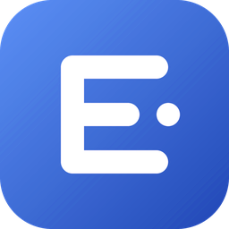

# EsyPOS

**Simple POS for Every Business**

Free · Offline-first · Installable · Backed up to your own Google Drive

[**Open App**](https://mhitlimited.github.io/pos/) · [Privacy Policy](privacy.html) · [Terms of Service](terms.html)

`v10.2` &nbsp;·&nbsp; PWA &nbsp;·&nbsp; HTML / CSS / JavaScript &nbsp;·&nbsp; by MH IT Limited

---

## Screenshots

Swipe or scroll sideways to browse.

<table>
<tr>
<td align="center">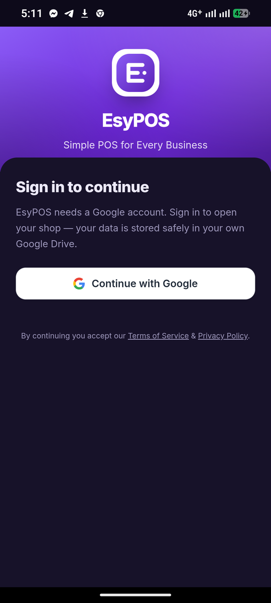</td>
<td align="center">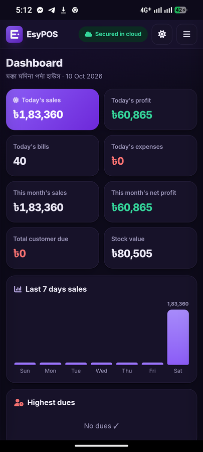</td>
<td align="center">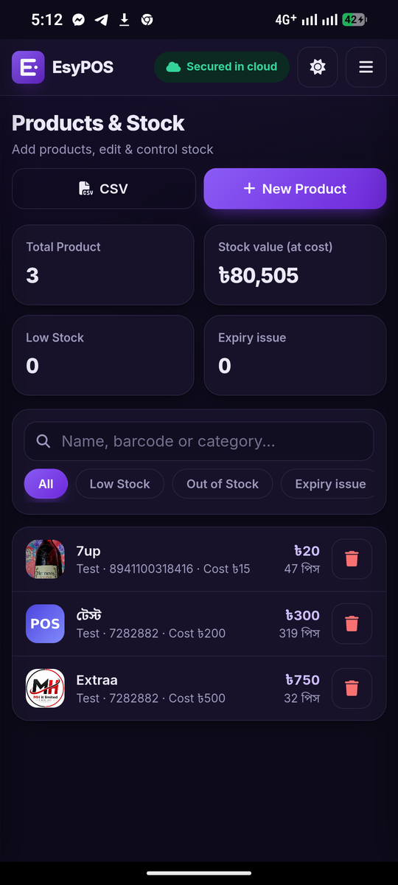</td>
<td align="center">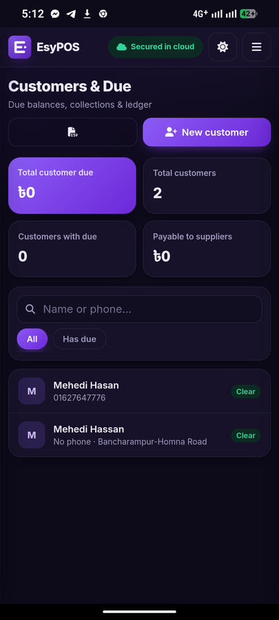</td>
<td align="center">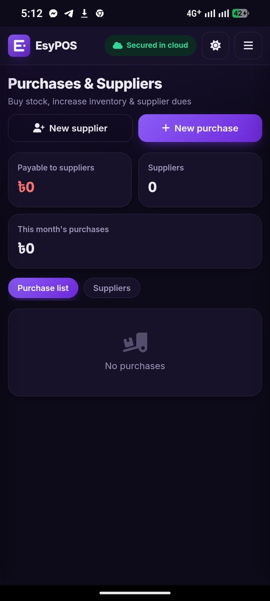</td>
<td align="center">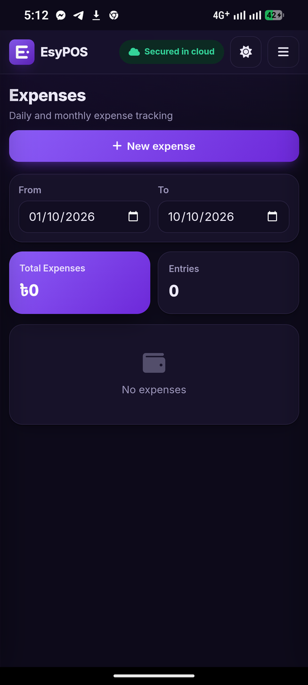</td>
<td align="center">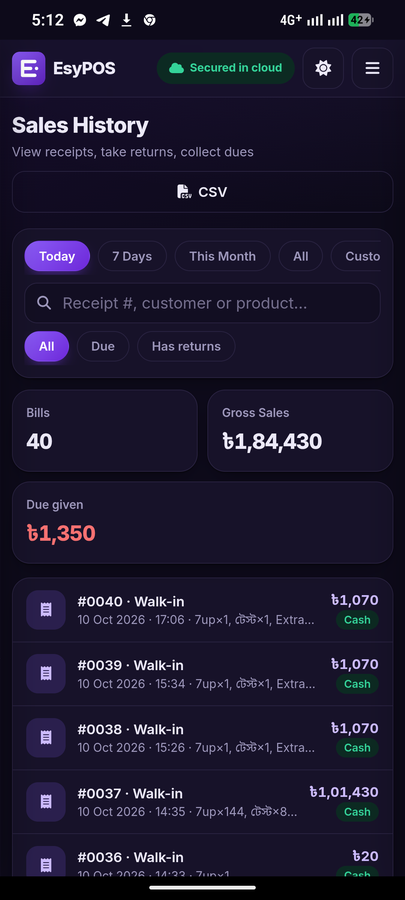</td>
<td align="center">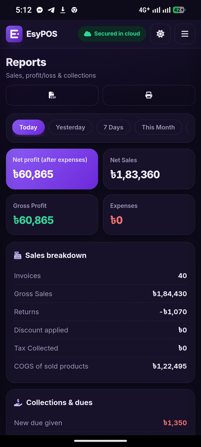</td>
<td align="center">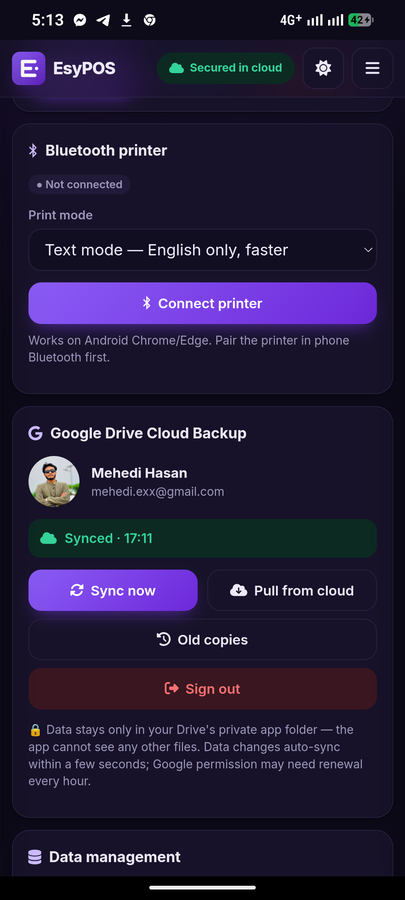</td>
<td align="center">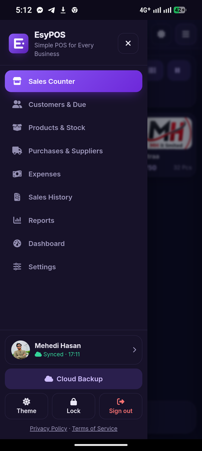</td>
</tr>
<tr>
<td align="center">Sign in</td>
<td align="center">Dashboard</td>
<td align="center">Products &amp; Stock</td>
<td align="center">Customers &amp; Due</td>
<td align="center">Purchases</td>
<td align="center">Expenses</td>
<td align="center">Sales History</td>
<td align="center">Reports</td>
<td align="center">Cloud Backup</td>
<td align="center">Menu</td>
</tr>
</table>

---

## About

EsyPOS is a free point-of-sale web app for small and medium shops. It runs in any modern browser, installs on phone or desktop like a native app, works without internet, and backs up your data to **your own Google Drive**. No server. No subscription.

> **বাংলায়:** EsyPOS একটি ফ্রি, অফলাইনে চলা POS সফটওয়্যার। বিক্রি, স্টক, বাকি, সরবরাহকারী, খরচ, রিটার্ন ও লাভ-ক্ষতির রিপোর্ট — সব এক অ্যাপে। ডেটা আপনার নিজের Google Drive-এ নিজে থেকেই ব্যাকআপ হয়।

## Features

| | |
|---|---|
| **Sales Counter** | Product search, barcode scan (camera / USB / Bluetooth), discount, tax, hold & resume bills |
| **Payments** | Cash, Card, Mobile banking, Due; quick-cash buttons, partial payment |
| **Receipts** | Print (58 / 80 mm), Bluetooth thermal printer, share via WhatsApp or SMS |
| **Customers & Due** | Ledger, due collection, reminders, credit limit |
| **Products & Stock** | Photo, barcode, category, expiry, low-stock alerts, CSV import / export |
| **Purchases & Suppliers** | Stock-in, supplier dues and payments |
| **Returns & Expenses** | Returns restore stock; expense tracking by category and date |
| **Reports & Dashboard** | Net sales, gross / net profit, collections, 7-day chart, top products |
| **Security & Backup** | PIN lock, auto Google Drive sync, daily snapshots, restore old copies |
| **Experience** | Light / dark theme, Bengali names and `৳` support, lakh-crore number format |

## Quick Start

1. Open the app: **https://mhitlimited.github.io/pos/**
2. Sign in with Google and add your products.
3. On your phone, choose **Install app** / **Add to Home screen**.

## Privacy Policy (Summary)

- All shop data is stored on **your device**; EsyPOS has **no backend server** and does not see, collect or sell your data.
- Google sign-in is optional. It uses only the `drive.appdata` scope (plus basic profile) and stores backups in a hidden app folder of **your own** Google Drive. The app cannot access any other Drive file.
- No analytics, ads or tracking.
- Camera is used only for barcode scanning; Bluetooth only for printing. Nothing is recorded or uploaded.
- You can delete data anytime: **Settings → Data management**, or sign out and revoke access at [myaccount.google.com/permissions](https://myaccount.google.com/permissions).

Full text: [privacy.html](privacy.html)

## Terms (Summary)

- EsyPOS is provided **free and "as is"**, without warranty.
- You are responsible for **regular backups**, the accuracy of your records and your customers' data.
- Tax / VAT figures are an aid only, not legal or accounting advice.
- The app's code, design, name and logo belong to MH IT Limited; you own your business data.
- Governed by the laws of Bangladesh.

Full text: [terms.html](terms.html)

## Contact

**MH IT Limited** · mehedi.exx@gmail.com · [dhakasmm.com](https://dhakasmm.com)

© MH IT Limited · EsyPOS

